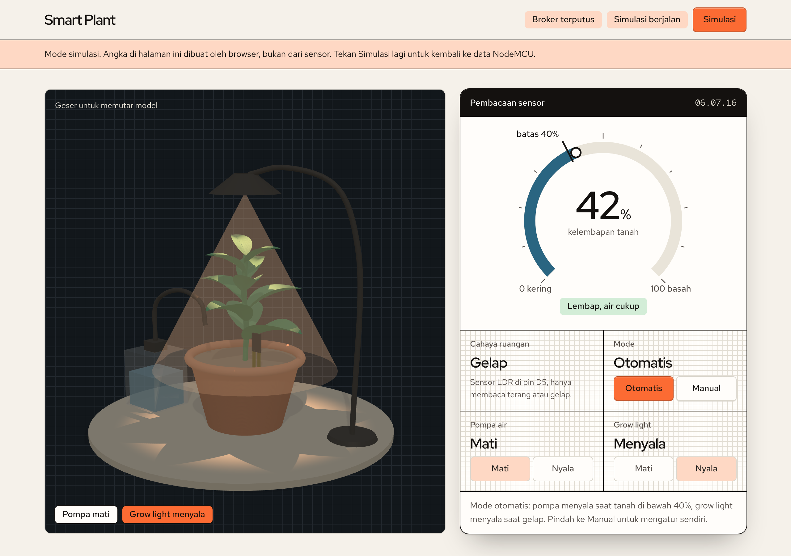

# Smart Plant — Tugas Besar IoT 2026

Dashboard web untuk sistem penyiraman dan pencahayaan tanaman otomatis berbasis NodeMCU ESP8266.



## Cara kerja

- NodeMCU mengirim data sensor tiap 2 detik ke broker MQTT publik `broker.hivemq.com` (port 1883).
- Halaman ini terhubung ke broker yang sama lewat WebSocket aman (`wss://broker.hivemq.com:8884/mqtt`).
- Topik data: `smartplant/tubes2026/data` — JSON `{"soil":41,"dark":false,"autoMode":true,"pump":false,"lamp":false}`
- Topik kendali: `smartplant/tubes2026/control` — `MODE_AUTO`, `MODE_MANUAL`, `PUMP_ON`, `PUMP_OFF`, `LAMP_ON`, `LAMP_OFF`

## Isi halaman

- Model 3D tanaman yang mengikuti sensor: daun layu saat tanah kering, air menetes saat pompa menyala, grow light dan suasana siang/malam mengikuti LDR.
- Kartu pembacaan sensor: alat ukur kelembapan tanah dengan penanda batas siram 40%, cahaya, mode, pompa, dan grow light.
- Grafik 5 menit terakhir, statistik sesi, dan catatan kejadian.
- Tombol **Simulasi** (atau buka `index.html#simulasi`) untuk mencoba tampilan tanpa alat. Data simulasi dibuat browser, bukan dari sensor.

## Menjalankan di komputer

```bash
npm start
```

Lalu buka `http://localhost:8080`. Tidak ada dependensi dan tidak ada proses build: `server.js` hanya melayani `index.html` dan folder `vendor/` (berisi `mqtt.js` 4.3.7 dan `three.js` r149). Membuka `index.html` langsung di browser juga bisa.

## Deploy otomatis ke Azure Web App

Workflow `.github/workflows/azure-webapp.yml` men-deploy setiap ada push ke `main`. Workflow ini dilewati sampai langkah berikut selesai:

1. Buat Web App di Azure Portal: Publish **Code**, Runtime stack **Node 20 LTS**, sistem operasi **Linux**.
2. Di Web App: **Settings → Configuration → General settings**, nyalakan **SCM Basic Auth Publishing Credentials**, lalu simpan.
3. Di halaman **Overview** Web App, klik **Download publish profile**.
4. Di GitHub: **Settings → Secrets and variables → Actions**.
   - Tab **Secrets**: buat `AZURE_WEBAPP_PUBLISH_PROFILE`, isi dengan seluruh isi berkas publish profile.
   - Tab **Variables**: buat `AZURE_WEBAPP_NAME`, isi dengan nama Web App.
5. Push ke `main`, atau jalankan workflow dari tab **Actions**.

Azure menjalankan `npm start`, dan server membaca port dari variabel `PORT` yang diberikan Azure.

## Desain

Tampilan mengikuti aturan [Hallmark](https://github.com/nutlope/hallmark) dengan tema Furrow: kertas manila, tinta hitam, huruf Red Hat, dan satu warna sinyal jingga.
